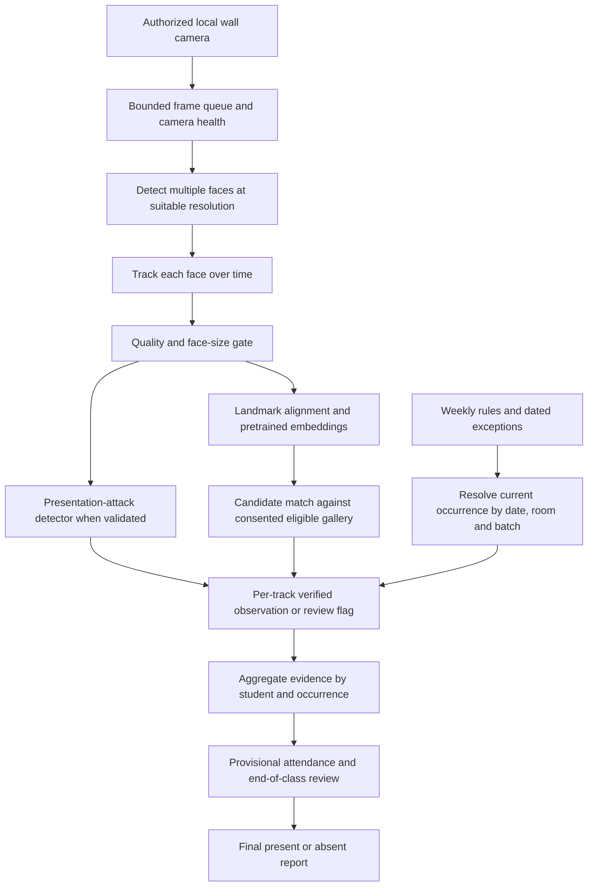

# Classroom attendance system design

Status: proposed design, prepared 2026-10-26. This document specifies the requested revision; the running application has not yet been changed. Source facts are in classroom-source-review.md. Unresolved values stay visibly unresolved, not guessed.

## Objective

Replace individual check-in with a front-wall camera observing the classroom, recurring timetable-driven sessions, a complete student roster, photo/video enrollment, and date/class attendance reports. Automatically accumulate reliable presence evidence and propose absences at session end. Suspected presentation attacks create review events, not accusations or automatic penalties.

## Architecture choice

Keep the local React/FastAPI application and SQLite initially. Use a persistent backend capture/inference worker independent of browser rendering, a scheduler, and separate attendance aggregation. Browser JPEG uploads at 640 px are unsuitable as the permanent whole-room capture path. The wall-mounted camera connects by local USB/UVC first; a configured RTSP adapter is a future-compatible input. Local uploaded clips support consented offline experiments, never live attendance records.

Alternatives considered:
- Browser-only capture: quick to extend, but stops when a browser tab closes and existing resolution/queueing is poor for distant faces. Retain for student enrollment and small experiments only.
- Local backend camera worker: recommended for persistent wall-camera monitoring, native-resolution capture and bounded inference queues. Runs only during explicitly enabled monitoring periods; closes the device outside those periods.
- Multi-camera/GPU deployment: possible extension if measured coverage fails; not assumed necessary or guaranteed to work before a site test.

The user already selected wall-camera monitoring. Hardware, distance and attendance-rule answers remain pending. A high-resolution camera is not by itself a guarantee of readable faces or reliable anti-spoofing. Do not promise to recognize all 63 students from one view without measuring back-row coverage.

## Navigation and page design

Preserve the existing white/slate/teal visual system. Responsive desktop-first pages, accessible navigation names, text status labels alongside colors, keyboard-operable dialogs, empty/error/loading states.

1. **Live attendance** (`/live`): camera monitoring, multi-face overlays, current-session details, observed present / pending / review counts, camera coverage and health, recent recognition evidence. Remove session-name input and Start/End session form from this page. Keep a camera monitoring toggle, because automatic scheduling must not silently activate capture without operator consent.
2. **Session control** (`/sessions`): Monday–Saturday timetable with full course/lab name, teacher, start/end time, section, batch, room and effective date. Tabs: Weekly timetable; Date exceptions; Monitoring setup. Actions: edit weekly rule with effective date, cancel a single occurrence, replace/move an occurrence, atomically swap two occurrences, restore exception, and explicitly create an extra class. Preview impacted date/room/batch and conflicts before saving. Display unresolved faculty/room as “To confirm.”
3. **Students** (`/students`): small empty photo placeholder, student name, roll number, email, section, batch. Search/filter section/batch/enrollment. Last table column is Batch as requested. Enrollment state appears as a small badge under the name or inside the detail panel. Roster import and face enrollment are separate operations. No phone or CGPA fields, API values, exports, search indexes or logs.
4. **Attendance records** (`/attendance`): select date first, then class occurrence (full course, time, batch, room); render the full eligible roster, not just recognized people. Columns exactly: Student Name | ID/Roll No | Section | Session | Time | Absent or Present. Time is first accepted sighting in local time or “—”; session label includes scheduled interval. During a running/unreviewed session show Pending/Needs review rather than falsely labeling absence; finalized reviewed reports use Present/Absent. Audit detail and flagged evidence are available by opening a row, not extra default columns. Export selected date/class, not all records accidentally.
5. **Review flags** (`/reviews`): timestamp, session, track, reason, model version/score and resolution state. Candidate name only when supported by recognition; unidentified tracks stay anonymous. Reviewer can accept/reject evidence and correct attendance with a reason. Never label a student “cheater.”
6. **Accuracy lab** (`/accuracy`): verification, open-set identification, classroom coverage, tracking stability, presentation-attack performance, and end-to-end attendance errors. Clearly separate test footage and real session records.

Enrollment routes: `/students/new`, `/students/:student_id/enrollment`; source options Live camera / Photo(s) / Video. Roster-only create is permitted without face data. Do not retain “Volunteer” copy or `/people` frontend routes. Source citations and historical archived documents are not blindly search-and-replaced.

## Example live layout

```text
Live attendance                          Camera: Room B 00/6
Current course • teacher • section/batch • local start/end time

[Present so far] [Pending] [Needs review] [Camera coverage]

┌──────────────────────────────────┬──────────────────────────┐
│ Whole-class live preview         │ Current session          │
│ Multiple tracked face boxes      │ Deep Learning            │
│ Labels only for accepted matches │ Teacher: SA — to confirm │
│ Small faces: unresolved          │ 11:00–12:00 • Section D   │
│ Monitoring start/stop            │ Room B 00/6              │
└──────────────────────────────────┴──────────────────────────┘
Recent verified observations       Review flags (if any)
```

At recess, cancellation or an empty timetable slot: “No active class,” next-class summary and no automatic absence. Multiple simultaneous labs are separate occurrences in different rooms; one camera does not observe all of them. Camera-to-room configuration selects the correct occurrence. Unresolved conflict shows a conflict state and disables attribution.

## Recognition and attendance data flow



Keep YuNet/SFace as the reproducible baseline. Benchmark alternatives only if classroom evidence shows unacceptable missed faces or identification errors. Tracking uses spatial association and temporal continuity; never count two adjacent tracks as the same identity merely because their boxes overlap. Detect at a measured cadence and embed only quality-qualified new or refreshed tracks. Bound the queue and drop stale frames instead of accumulating minutes of delayed decisions.

The current code needs structural replacement: `vision.extract` rejects multiple faces, `Camera.jsx` shrinks to 640 px, `Stability` maintains one identity per stream, `people` conflates roster and face enrollment, and `attendance` stores only successful entries.

## Presence and absence semantics

Proposed default awaiting user choice: at least three verified observation windows, with a configurable minimum separation (initial experiment: 60 seconds) and at least three consistent samples within each window. This measures repeated sightings; it does not prove continuous participation. Freeze chosen policy/model/gallery versions on each occurrence. A single-uploaded image or offline clip can never mark live attendance.

Internal states: Pending, Present, Needs review, Absent, Not applicable. Final teacher-reviewed attendance uses Present/Absent. Cancelled/recess/not-enrolled-in-course rows are Not applicable and excluded from absence denominators.

- At start, snapshot the eligible roster for that occurrence; do not start with everyone Absent.
- Qualified repeated observations transition Pending to provisional Present.
- At end, an unobserved eligible student becomes an absence candidate, not a proven absence.
- Monitoring downtime, unresolved identity, insufficient face size, missing consent/template or camera coverage failure create Needs review. A roster entry without a biometric template is not evidence of absence.
- Finalization presents the proposed absences and flagged cases to the teacher; corrections require a reason and are audit logged. No automatic punitive messages or consequences.
- If the backend was off during a class, mark the occurrence unmonitored; do not invent observations or backfill absences.
- Suspicious evidence is excluded from positive presence windows. A suspicious later observation must not erase an earlier valid sighting. Flag resolution recomputes only affected provisional evidence, preserving published report revisions.

Final policy choices (sighting count, time separation, percent-time alternative, observation start/end grace) are configuration and evaluation decisions. The system must visibly describe the selected rule to the teacher.

## Presentation-attack detection

Add a dedicated passive PAD model behind a versioned interface, after checking license, preprocessing and CPU/GPU performance. Recognition confidence, face motion, blinking or static posture alone are not reliable spoof detectors. Do not implement “not blinking = fake.”

PAD result: `live_supported`, `suspected_attack`, or `indeterminate`, with reason and quality. No validated model or insufficient crop quality must produce indeterminate, never an invented “live” score. Suspected attack flags request review; no claim that a particular absent student supplied the photo.

Evaluate printed photos, phone-displayed photos and replay videos, plus genuine students at front/middle/back rows under varied lighting. Report APCER (attack accepted as bona fide), BPCER (genuine rejected as attack), unknown/indeterminate rate, and attendance errors separately. Calibrate and test with disjoint subjects/recordings/attack media where feasible. If the one-camera setup cannot resolve attacks, report the limitation and use teacher verification; do not advertise guaranteed prevention.

## Student photo and video enrollment

Separate profile thumbnail from biometric template. Imported roster thumbnails stay empty. Later thumbnail creation requires explicit save consent; UI copy must change from universal “no photos saved” to explain that selected profile thumbnails are stored, while live classroom frames are not stored by default.

- Photo(s): validate actual decoded format, orientation, dimensions and file size; reject no face or multiple faces for enrollment. One photo may create a low-coverage template but is visibly incomplete for classroom auto-recognition until minimum diverse samples are met (initial target 5). Do not fake diversity by making many crops from one photo.
- Video: local multipart upload, bounded size/duration (proposal: 100 MB / 60 seconds), decode without shell interpolation, ignore audio, sample spaced timestamps, remove near-duplicate frames, quality-filter and check identity consistency. Show accepted/rejected counts and selected frames before confirmation.
- Keep upload processing separate from live anti-spoofing: a legitimate enrollment photo is not a live attendance event, and enrollment video is not proof of current presence.
- Protect storage paths and filenames; no executable uploads or external-URL fetch input. Delete temporary originals after completion/cancellation and by startup cleanup after crashes. State retention limits clearly.
- Enrollment is bound to the selected student and reviewed by the operator. A person's ability to upload an image does not prove that image belongs to their claimed roll number.

## Persistent model

Use UUID `student_id` for internal references and separate unique `(section, roll_no)` display identity. Rename legacy `person_id` foreign keys through an explicit migration. Do not reinterpret an old internal UUID as a new roll number.

| Table | Key data |
|---|---|
| students | id, roll_no, name, email, section, batch_id, photo_path nullable, enrollment_state, active |
| student_consents | student_id, purpose, version, consent_at, revoked_at |
| face_templates | student_id, model_version, normalized embeddings, aggregate, capture_source, quality_summary |
| courses / teachers / rooms / batches | full labels, original source code, confirmation status |
| course_enrollments | student_id, course_id, valid_from, valid_to; necessary for Honors/electives |
| timetable_rules | weekday, local start/end, course, teacher, room, section/batch, effective_from/to, version |
| schedule_exceptions | local date, original occurrence key, cancel/replace/swap, replacement details, reason, audit actor |
| class_occurrences | unique rule-version/date, actual start/end UTC, local date, room, status, frozen roster/policy/model/gallery |
| camera_sources / camera_health | source config, room_id, monitoring authorization, uptime and gaps; credentials never exported |
| observations | occurrence_id, track_id, student_id nullable, event time, quality, match, PAD result, model version; no raw frame default |
| attendance | occurrence_id, student_id, provisional/final status, first/last seen, accepted windows, reviewer revision |
| review_events / audit_log | event/reason, evidence metadata, resolution, actor, timestamps; no automatic discipline |

Recurring rules are local Asia/Kolkata wall time; persisted observations use UTC. A class interval is start-inclusive/end-exclusive. Semester end must be set before activating recurrence. Preserve finalized occurrence snapshots when weekly rules, roster membership or faculty change later.

Migrate transactionally with backup and schema version. Imported rows have enrollment_state=not_enrolled and no biometric consent. Preserve old standalone sessions as legacy manual occurrences with only their actual recorded students; do not infer historical absences. Initial SQLite WAL is sufficient for this prototype; abstract repositories to enable PostgreSQL later. Inference/scheduling ownership remains explicit single-worker until leases/shared state are implemented.

## Schedule correctness

Weekly edits require an effective date. Dated cancellation affects that date only. Swaps update both occurrences in one transaction. Conflict validation covers overlapping room, batch and teacher assignments; unknown teacher codes are not assumed conflict-free. Exception resolution order: cancellation/replacement for date > effective weekly rule. Completed attendance is never silently rewritten by timetable editing.

Treat batch labels B1 and D1 as separate until mapping is confirmed. Parallel labs are valid across different rooms/batches. Unknown eligibility for Honors/electives/MDM blocks automatic absent classification, not viewing the schedule.

## Accuracy-first rollout

1. Validate roster/timetable and establish source conflicts; do not guess missing data.
2. Implement academic pages and migrations independently of biometrics.
3. Measure camera coverage with consenting participants in front/middle/back seats: native face size, blur, pose, occlusion, inference latency and recognized fraction.
4. Implement multi-face tracking and test identity switches, duplicate tracks, leaving/re-entry and camera disconnection.
5. Collect separate enrollment, validation and test sessions. Evaluate at full gallery size, plus unknown participants. Report per-row/condition performance rather than only a pooled accuracy.
6. Add and separately validate PAD. Do not enable automatic presence from indeterminate evidence until an explicitly defined review policy is implemented.
7. Integrate roster-complete proposed absences and teacher review. Demonstrate cancellation, batch eligibility, timetable swap, outage and export.

Acceptance measures: known recognition accuracy, wrong-identity rate, FAR/FRR, unknown rejection, missed-detection/quality-failure rates, tracking ID switches, false presence/absence per student-session, PAD APCER/BPCER, p50/p95 end-to-end latency, usable camera uptime. Report sample and participant counts and confidence intervals where defensible. No biometric performance claims from synthetic-vector unit tests.

## Pending inputs

Camera/resolution and back-row distance; attendance rule; semester end; batch alias mapping; unresolved faculty/course codes; CN lab assignment conflict; room mapping and elective/Honors participation. Staging and academic-page planning can proceed while these are pending. Reliable whole-class recognition and final attendance policy cannot be promised before their validation.

## Technical sources

- NIST face presentation-attack evaluation: https://www.nist.gov/publications/face-analysis-technology-evaluation-fate-part-10-performance-passive-software-based
- Face image size/pose/occlusion limitations: https://learn.microsoft.com/en-us/azure/foundry/responsible-ai/face/characteristics-and-limitations
- OpenCV baseline: https://docs.opencv.org/4.x/d0/dd4/tutorial_dnn_face.html
